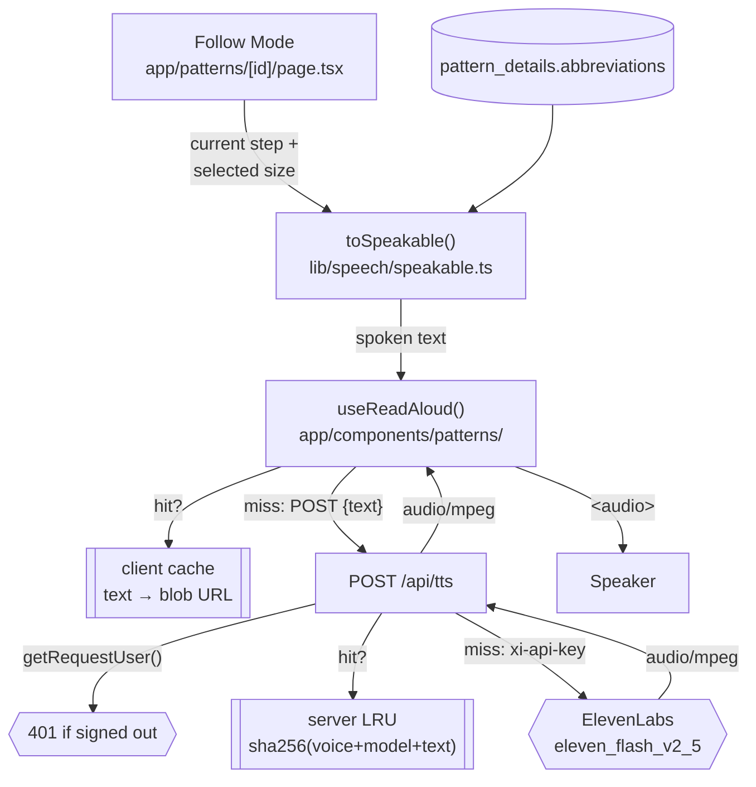
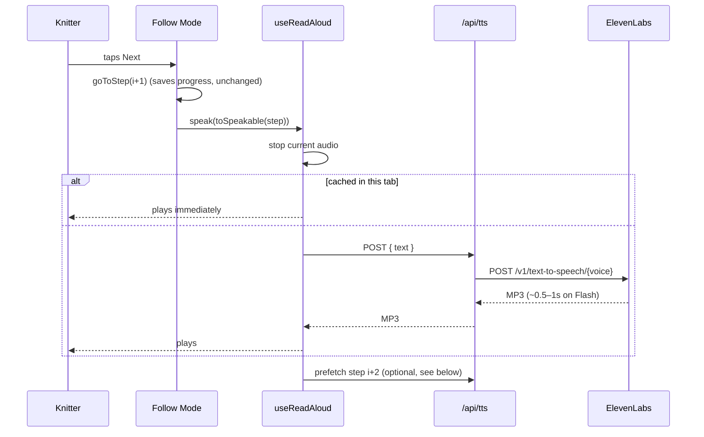

# Read-Aloud in Follow Mode (ElevenLabs)

Hands-free narration of pattern instructions while knitting.

> **Status: design — not built yet.** This is the plan for branch
> `worktree-elevenlabs-read-aloud`. Anything marked ⚠️ is a known limitation or
> open question, not settled behaviour.

---

## TL;DR

Knitters have both hands on the needles and their eyes on the stitches. Follow
Mode already walks a pattern one instruction at a time; this adds a voice.

1. **Speakable text is built on the client** from data Follow Mode already has:
   the row label, the row flags, the instruction text for the selected size, and
   the pattern's own abbreviations.
2. **`POST /api/tts`** forwards that text to ElevenLabs and streams back MP3.
   The API key never leaves the server.
3. **The browser plays it**, either on tap (🔊) or automatically each time the
   knitter moves to a new step (Auto-read).

Phase 1 (this doc) is text-to-speech only. Voice commands ("next", "repeat
that") are Phase 2 — see [Later](#later).

---

## Architecture



Nothing new is written to the database. Progress saving is unchanged: moving
between steps still goes through the existing `goToStep` → `PUT /api/patterns/[id]/wip`.

---

## Sequence: Auto-read on



---

## Components

### `lib/speech/speakable.ts` — what gets said

Pure function, no I/O, so it is easy to test once Vitest lands.

`toSpeakable(instruction, { size, abbreviations }) → string`

| Input | Spoken |
|---|---|
| `row_start: 14` | "Row 14." |
| `row_start: 3, row_end: 10` | "Rows 3 to 10." |
| `is_setup_row` / `is_decrease_row` / `is_increase_row` | "Setup row." / "Decrease row." / "Increase row." |
| `size_variations[size]` ?? `instruction_text` | the body, same choice `textForSize()` makes on screen |
| `is_repeat && repeat_count` | "Repeat 4 times." |
| `notes` | "Note: …" at the end |

**Abbreviations are expanded before speech.** TTS reads "ssk" as a word and
"k2tog" as gibberish. Expansion order:

1. The pattern's own `details.abbreviations` (from extraction), which win on conflict.
2. A built-in table of standard terms: `k`→knit, `p`→purl, `k2tog`→knit two together,
   `ssk`→slip slip knit, `yo`→yarn over, `RS/WS`→right/wrong side, `pm/sm`→place/slip
   marker, `st(s)`→stitch(es), `rep`→repeat, `*`→"star", and so on.
3. Stitch + count forms: `k2`→"knit 2", `p3`→"purl 3".

Matching is whole-token and case-insensitive, longest key first, so `k2tog`
is never split into `k2` + `tog`.

⚠️ Chart, schematic and stitch-pattern sections have no `instructions` rows and
never appear in `flatSteps`, so they are not read. That is the same coverage as
Follow Mode today.

### `POST /api/tts` — the only thing that touches ElevenLabs

```
POST /api/tts
{ "text": "Row 14. Decrease row. Knit 1, knit two together, …" }
→ 200 audio/mpeg
```

- **Auth:** `getRequestUser()` and a `401` when signed out, matching every other route.
  Without this, the endpoint would be an open proxy spending your ElevenLabs credits.
- **Limits:** reject `text` over 1,500 characters (`413`). The longest real rows are a
  few hundred characters, and the cap bounds the cost of a single request.
- **Upstream call:** `POST https://api.elevenlabs.io/v1/text-to-speech/{voice_id}?output_format=mp3_44100_64`
  with header `xi-api-key`, body `{ text, model_id: "eleven_flash_v2_5" }`.
  Flash is the low-latency and low-cost model; it matters more that "Next" feels
  instant than that the voice is studio quality.
- **Cache:** an in-memory LRU keyed by `sha256(voice + model + text)`, capped at around
  50 MB. Rows repeat a lot ("Knit to end", "Rep rows 3–4"), so this is cheap and
  catches a lot.
- **Errors:** an ElevenLabs 4xx/5xx becomes `502 { error }`. The upstream body is
  logged but never echoed to the client.

### `useReadAloud()` — playback state

`app/components/patterns/useReadAloud.ts`

```ts
const { speak, stop, status /* idle | loading | playing | error */ } = useReadAloud()
```

- Holds one `HTMLAudioElement`. `speak()` always stops whatever is playing first,
  so tapping Next quickly never stacks voices.
- Keeps a per-tab `Map<text, blobURL>` so Previous → Next replays without a request.
- Stops on unmount and when leaving Follow Mode.
- Ignores a stale response: if the knitter moves on while a request is in flight,
  the late audio is dropped rather than played.

### UI changes in Follow Mode

- **🔊 Read aloud** button beside the row label in the instruction card. It shows
  a spinner while `loading` and works as a stop button while `playing`.
- **Auto-read** toggle in the top bar, next to the size badge. It is stored in
  `localStorage` (a per-device preference, same approach as `sidebarState`) and
  wrapped in try/catch.
- When Auto-read is on, `useEffect` on `currentStepIndex` calls `speak()`.
- ⚠️ Browsers block audio that isn't started by a user gesture. Turning Auto-read on
  is a tap, and that tap unlocks playback for the session. After a full page reload
  (for example `?resume=1`), the first row may need one tap.

---

## Configuration

`.env.local` (and the template in `.env.example`):

```bash
# ─── ElevenLabs (read-aloud in Follow Mode) ─────────────────
ELEVENLABS_API_KEY=sk_...
# Optional. Defaults to a premade voice; any voice ID from your ElevenLabs library works.
# ELEVENLABS_VOICE_ID=21m00Tcm4TlvDq8ikWAM
```

If the key is missing, `/api/tts` returns `503` and the 🔊 controls hide
themselves, so the app works without ElevenLabs.

---

## Cost

Rough numbers to sanity-check, not a quote. ElevenLabs bills per character.

- A typical row spoken: ~80–200 characters.
- A sweater with ~400 steps read once: roughly 40–80k characters.
- The server cache plus the client cache mean re-reads and repeated rows are free.

⚠️ The in-memory cache resets on each deploy or cold start (Vercel functions
are ephemeral). See below.

---

## Later

**Phase 1.5 — persistent cache.** Store MP3s in a Supabase Storage bucket keyed
by the same hash, so audio survives deploys and is generated once per unique row
across all users. This needs a new bucket plus a migration, which is why it
isn't in Phase 1.

**Phase 1.5 — prefetch.** After playing step *i*, quietly fetch step *i+1* so
the next "Next" plays instantly.

**Phase 2 — voice control** with ElevenLabs Conversational AI (or speech-to-text
plus a small intent matcher):

| Utterance | Action |
|---|---|
| "next" / "previous" | `goToStep(i ± 1)` |
| "repeat that" | `speak()` the current step again |
| "what row am I on?" | speak the label and progress |
| "what's an ssk?" | look up the glossary and speak the definition |
| "count" | bump the `StitchCounters` row counter |

This needs microphone permission and an always-listening UX, so it should be
its own design review.

---

## Files touched (Phase 1)

| File | Change |
|---|---|
| `app/api/tts/route.ts` | **new** — auth, limits, LRU, ElevenLabs call |
| `lib/speech/speakable.ts` | **new** — instruction → spoken text |
| `app/components/patterns/useReadAloud.ts` | **new** — playback hook |
| `app/patterns/[id]/page.tsx` | 🔊 button, Auto-read toggle, effect on step change |
| `.env.example` | `ELEVENLABS_API_KEY`, `ELEVENLABS_VOICE_ID` |
| `CLAUDE.md` | add `/api/tts` to the API routes list |
